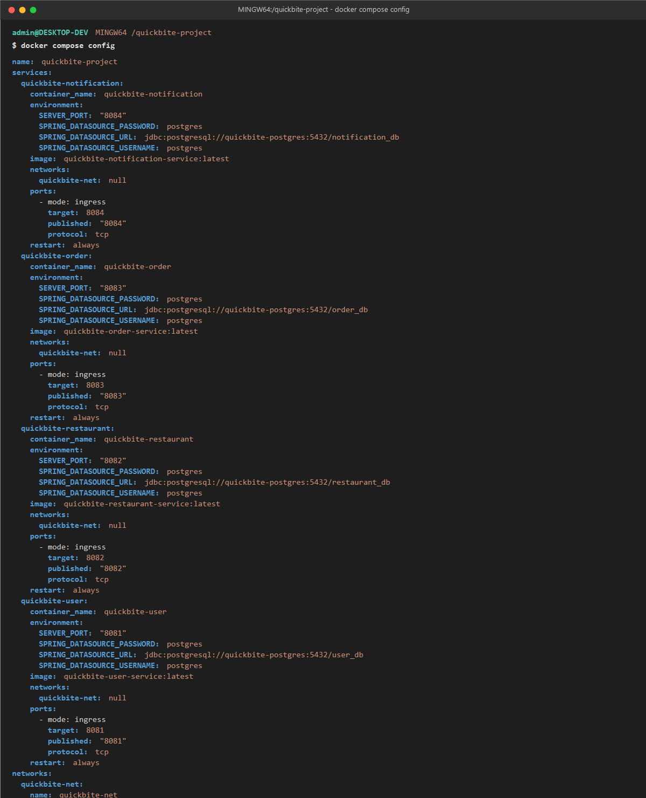

# Bài tập: Cấu hình biến môi trường qua tệp .env (QuickBite Project)

## 1. Mục tiêu
* Tổ chức cấu hình khoa học bằng cách phân tách biến môi trường ra tệp `.env` dùng chung.
* Sử dụng tiền tố (prefix) riêng biệt cho từng dịch vụ để tránh xung đột key trong kiến trúc microservices.
* Sử dụng cú pháp nội suy `${...}` trong `docker-compose.yml`.

---

## 2. Bảng tham chiếu biến môi trường

| Nhóm Dịch Vụ | Các biến môi trường cấu hình |
| :--- | :--- |
| **Dùng chung** | `DB_HOST`, `DB_PORT` |
| **User** | `USER_DB_NAME`, `USER_DB_USERNAME`, `USER_DB_PASSWORD`, `USER_SERVER_PORT` |
| **Restaurant** | `RESTAURANT_DB_NAME`, `RESTAURANT_DB_USERNAME`, `RESTAURANT_DB_PASSWORD`, `RESTAURANT_SERVER_PORT` |
| **Order** | `ORDER_DB_NAME`, `ORDER_DB_USERNAME`, `ORDER_DB_PASSWORD`, `ORDER_SERVER_PORT` |
| **Notification** | `NOTIFICATION_DB_NAME`, `NOTIFICATION_DB_USERNAME`, `NOTIFICATION_DB_PASSWORD`, `NOTIFICATION_SERVER_PORT` |

---

## 3. Cấu hình tệp tin

### File `.env.example` *(Commit lên Git làm template mẫu)*:
```env
# ==========================================
# CẤU HÌNH DÙNG CHUNG (SHARED DATABASE CONFIG)
# ==========================================
DB_HOST=quickbite-postgres
DB_PORT=5432

# ==========================================
# USER SERVICE CONFIGURATION
# ==========================================
USER_DB_NAME=user_db
USER_DB_USERNAME=postgres
USER_DB_PASSWORD=your_user_db_password
USER_SERVER_PORT=8081

# ==========================================
# RESTAURANT SERVICE CONFIGURATION
# ==========================================
RESTAURANT_DB_NAME=restaurant_db
RESTAURANT_DB_USERNAME=postgres
RESTAURANT_DB_PASSWORD=your_restaurant_db_password
RESTAURANT_SERVER_PORT=8082

# ==========================================
# ORDER SERVICE CONFIGURATION
# ==========================================
ORDER_DB_NAME=order_db
ORDER_DB_USERNAME=postgres
ORDER_DB_PASSWORD=your_order_db_password
ORDER_SERVER_PORT=8083

# ==========================================
# NOTIFICATION SERVICE CONFIGURATION
# ==========================================
NOTIFICATION_DB_NAME=notification_db
NOTIFICATION_DB_USERNAME=postgres
NOTIFICATION_DB_PASSWORD=your_notification_db_password
NOTIFICATION_SERVER_PORT=8084
```

### File `.gitignore`:
```gitignore
# Không commit file .env chứa mật khẩu thật lên Git
.env
```

### File `docker-compose.yml`:
```yaml
version: '3.8'

services:
  # 1. User Service
  quickbite-user:
    image: quickbite-user-service:latest
    container_name: quickbite-user
    ports:
      - "${USER_SERVER_PORT}:${USER_SERVER_PORT}"
    environment:
      - SPRING_DATASOURCE_URL=jdbc:postgresql://${DB_HOST}:${DB_PORT}/${USER_DB_NAME}
      - SPRING_DATASOURCE_USERNAME=${USER_DB_USERNAME}
      - SPRING_DATASOURCE_PASSWORD=${USER_DB_PASSWORD}
      - SERVER_PORT=${USER_SERVER_PORT}
    networks:
      - quickbite-net
    restart: always

  # 2. Restaurant Service
  quickbite-restaurant:
    image: quickbite-restaurant-service:latest
    container_name: quickbite-restaurant
    ports:
      - "${RESTAURANT_SERVER_PORT}:${RESTAURANT_SERVER_PORT}"
    environment:
      - SPRING_DATASOURCE_URL=jdbc:postgresql://${DB_HOST}:${DB_PORT}/${RESTAURANT_DB_NAME}
      - SPRING_DATASOURCE_USERNAME=${RESTAURANT_DB_USERNAME}
      - SPRING_DATASOURCE_PASSWORD=${RESTAURANT_DB_PASSWORD}
      - SERVER_PORT=${RESTAURANT_SERVER_PORT}
    networks:
      - quickbite-net
    restart: always

  # 3. Order Service
  quickbite-order:
    image: quickbite-order-service:latest
    container_name: quickbite-order
    ports:
      - "${ORDER_SERVER_PORT}:${ORDER_SERVER_PORT}"
    environment:
      - SPRING_DATASOURCE_URL=jdbc:postgresql://${DB_HOST}:${DB_PORT}/${ORDER_DB_NAME}
      - SPRING_DATASOURCE_USERNAME=${ORDER_DB_USERNAME}
      - SPRING_DATASOURCE_PASSWORD=${ORDER_DB_PASSWORD}
      - SERVER_PORT=${ORDER_SERVER_PORT}
    networks:
      - quickbite-net
    restart: always

  # 4. Notification Service
  quickbite-notification:
    image: quickbite-notification-service:latest
    container_name: quickbite-notification
    ports:
      - "${NOTIFICATION_SERVER_PORT}:${NOTIFICATION_SERVER_PORT}"
    environment:
      - SPRING_DATASOURCE_URL=jdbc:postgresql://${DB_HOST}:${DB_PORT}/${NOTIFICATION_DB_NAME}
      - SPRING_DATASOURCE_USERNAME=${NOTIFICATION_DB_USERNAME}
      - SPRING_DATASOURCE_PASSWORD=${NOTIFICATION_DB_PASSWORD}
      - SERVER_PORT=${NOTIFICATION_SERVER_PORT}
    networks:
      - quickbite-net
    restart: always

networks:
  quickbite-net:
    external: true
```

---

## 4. Kiểm thử cấu hình nội suy (Verification)

Chạy lệnh kiểm tra cấu hình nội suy:
```bash
docker compose config
```

### Kết quả mong đợi:
Terminal in ra cấu hình hoàn chỉnh, các biến nội suy dạng `${...}` được phân giải thành giá trị thực tế và không có lỗi cú pháp.

### Bằng chứng thực nghiệm:
Hình ảnh chụp màn hình terminal lệnh `docker compose config` được lưu tại:
`homework/session_05/exercise_03/env_config.png`


